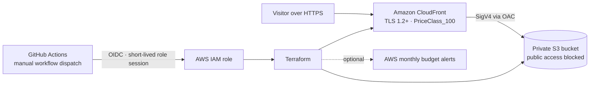

# AWS Cloud Environment Provisioner

A portfolio-sized Terraform project for a secure, cost-aware static site environment on AWS. It keeps the S3 origin private and serves the sample site over HTTPS through CloudFront and Origin Access Control (OAC). GitHub Actions can validate the configuration without AWS credentials; provisioning is an explicit, manually triggered workflow using short-lived GitHub OIDC credentials.

> **Nothing is deployed by default.** The deployment workflow only runs when manually dispatched, and it requires AWS/GitHub configuration. AWS resources can incur charges.

## Architecture



The bucket has public access blocked, bucket-owner-enforced ownership, and server-side encryption. Its bucket policy grants only `s3:GetObject` to the CloudFront service principal when the request comes from this distribution. CloudFront redirects HTTP to HTTPS, uses a managed caching policy, and adds browser security headers. No S3 website endpoint or long-lived AWS access key is used.

## What's included

- Terraform for the S3 origin, CloudFront distribution/OAC, restrictive bucket policy, security headers, and sample HTML content.
- Configurable AWS region, bucket name, project/environment tags, and optional monthly budget alerts.
- CI for Terraform formatting/validation and Trivy high/critical misconfiguration scanning.
- Trivy suppressions document the cost/security tradeoffs for WAF and customer-managed KMS in this demo.
- A `workflow_dispatch` deployment workflow supporting `plan`, `apply`, and `destroy`.
- [Setup, OIDC, and teardown](docs/deployment.md) and [cost guidance](docs/costs.md).

## Validate locally (no AWS credentials)

Install Terraform 1.10.5 (or a compatible release satisfying `versions.tf`) and run:

```sh
./scripts/validate.sh
```

This checks formatting, initializes providers with the AWS backend disabled, and validates the configuration. It does not create resources or contact AWS. The CI security scan also needs no AWS credentials.

## Deploy

Deployment is optional. Before triggering it, follow [the deployment setup](docs/deployment.md): create a remote state bucket, configure a GitHub OIDC IAM role and the `production` environment, and add the documented repository variables and secret. Then manually run **Actions → Provision AWS environment**, choosing `plan` first. Review the plan before separately dispatching `apply`.

Read [cost guidance](docs/costs.md) before provisioning. CloudFront distribution deployment can take several minutes. Use the same workflow's `destroy` operation when finished; see the teardown instructions for state and cleanup details.

## Repository layout

```text
.
├── .github/workflows/   # credential-free validation and opt-in OIDC deployment
├── docs/                # deployment, teardown, and cost guidance
├── scripts/validate.sh  # local/CI Terraform checks
├── site/                # sample site files uploaded to the private bucket
└── *.tf                 # Terraform root module
```
